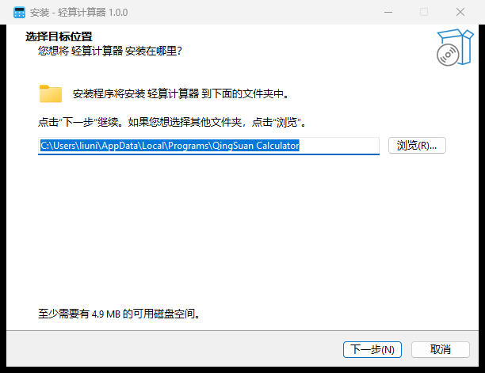
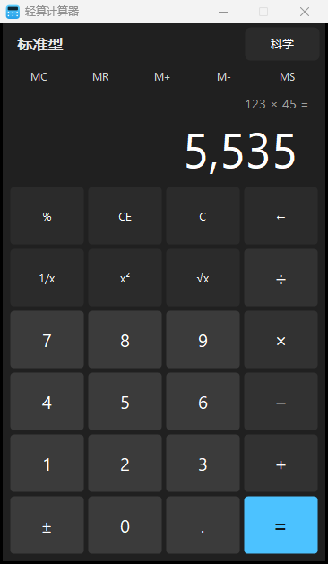
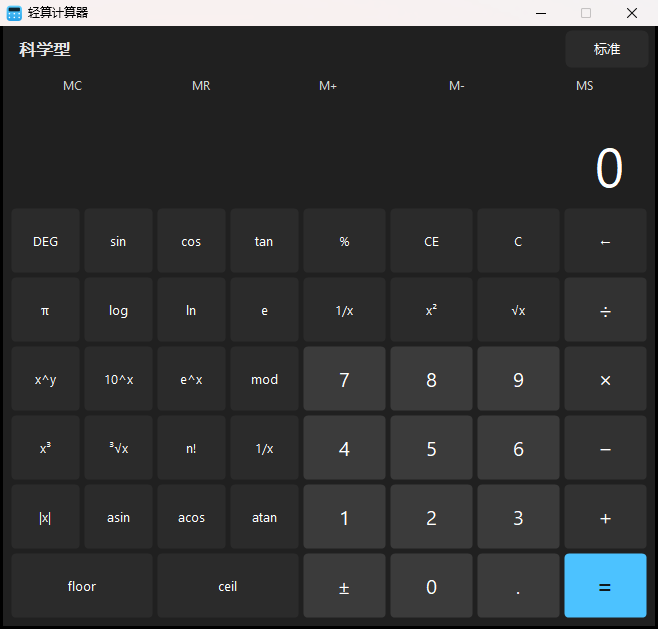

# 轻算计算器（QingSuan Calculator）

一个原生 Windows 计算器，**标准型 / 科学型**双模式，深色界面。C# + WinForms 编写，使用系统自带的 `.NET Framework` C# 编译器直接编译，**不依赖任何第三方运行时**；安装包用 Inno Setup 6 打包，体积小、启动快。

| 安装向导 | 标准型 | 科学型 |
| :---: | :---: | :---: |
|  |  |  |

---

## 目录

- [功能](#功能)
- [键盘快捷键](#键盘快捷键)
- [系统要求](#系统要求)
- [下载与安装](#下载与安装)
- [从源码构建](#从源码构建)
- [项目结构](#项目结构)
- [实现要点](#实现要点)
- [验证与测试](#验证与测试)
- [常见问题](#常见问题)

---

## 功能

### 标准型

- 四则运算 `+ - × ÷`
- 百分比 `%`、正负号 `±`
- 清除 `C` / `CE`、退格 `⌫`
- 倒数 `1/x`、平方 `x²`、开方 `√x`
- 内存 `MS / MR / M+ / M- / MC`
- 支持连续运算，连按 `=` 重复上次运算
- 千分位显示，除零有明确提示（「除数不能为零」）

### 科学型（标题栏右侧「科学」按钮，或 `Alt+2`）

- `sin cos tan`、`asin acos atan`（`DEG / RAD` 可切换）
- `log`、`ln`、`10^x`、`e^x`、`x^y`、`mod`
- `x³`、`³√x`、`n!`、`|x|`、`floor`、`ceil`
- 常量 `π`、`e`

### 界面

- 参照 Windows 11 计算器的深色布局：表达式行 + 大字号结果（超长自动缩小字号）
- 圆角扁平按钮自绘，悬停 / 按下反馈，按类型分色（数字、运算符、功能、强调、幽灵）
- DPI 感知（`app.manifest` 中 `dpiAware`），多显示器 / 缩放下不模糊

---

## 键盘快捷键

按 `Shift+1` 在程序内弹出快捷键说明。

| 按键 | 功能 |
| --- | --- |
| `0-9`、`.` | 输入数字 |
| `+ - * /` | 四则运算 |
| `Enter` / `=` | 计算结果 |
| `Shift+5` | 百分比 |
| `Shift+0` | 等号（`=`） |
| `Shift+8` | 乘法（`*`） |
| `Shift+1` | 快捷键说明 |
| `Backspace` | 退格 |
| `Delete` | 清除当前项（CE） |
| `Esc` | 全部清除（C） |
| `F9` | 正负号切换 |
| `R` | 倒数（1/x） |
| `Q` | 平方（x²） |
| `Alt+1` / `Alt+2` | 标准型 / 科学型 |

---

## 系统要求

- Windows 7 SP1 及以上（Windows 10 / 11 体验最佳）
- 需要 .NET Framework 4.x（Windows 10 / 11 已内置）
- 64 位与 32 位系统均可安装（安装包为 `x64compatible`，也可按当前用户安装、无需管理员权限）

---

## 下载与安装

安装包：`QingSuanCalculator-Setup-1.0.0.exe`（约 2.3 MB），在 Multica 项目的发布评论附件中。

- 双击安装，默认按**当前用户**安装到 `%LOCALAPPDATA%\Programs\QingSuan Calculator`，**无需管理员权限**；向导中也可以选择「为所有用户安装」。
- 安装完成后从**开始菜单 → 轻算计算器**启动，安装时勾选「创建桌面快捷方式」则桌面上也有图标。
- 卸载：**设置 → 应用 → 轻算计算器 → 卸载**，或开始菜单里的「卸载 轻算计算器」。

> **SmartScreen 提示**：本软件未做代码签名证书签名，首次运行 Windows 可能弹出「已保护你的电脑 / 未知发布者」。这是自建软件的正常现象，点**「更多信息 → 仍要运行」**即可。

---

## 从源码构建

### 依赖

| 工具 | 说明 |
| --- | --- |
| .NET Framework 4.x `csc.exe` | 系统自带，位于 `%WINDIR%\Microsoft.NET\Framework64\v4.0.30319\` |
| [Inno Setup 6](https://jrsoftware.org/isinfo.php) | 打包安装器，`winget install JRSoftware.InnoSetup` |

无需 Visual Studio、无需 .NET SDK。

### 构建

```powershell
# 在仓库根目录执行
powershell -ExecutionPolicy Bypass -File build.ps1
```

构建脚本分三步：

```
[1/3] 生成图标...        build\make-icon.ps1  ->  build\app.ico
[2/3] 编译 Calculator.exe  csc /target:winexe    ->  dist\Calculator.exe
[3/3] 打包安装程序...      ISCC build\installer.iss  ->  dist\QingSuanCalculator-Setup-1.0.0.exe
```

产物在 `dist\`：

- `Calculator.exe` —— 绿色版，双击即可运行（无外部依赖）
- `QingSuanCalculator-Setup-1.0.0.exe` —— 正式安装包

> 修改版本号时请同步 `src\Calculator.cs` 顶部的 `[assembly: AssemblyVersion]` 与 `build\installer.iss` 中的 `AppVersion` / `OutputBaseFilename`。

---

## 项目结构

```
.
├── README.md                  # 本文件
├── LICENSE                    # MIT 许可证
├── .gitignore                 # 忽略 dist/ 与生成的图标
├── build.ps1                  # 一键构建脚本（图标 → 编译 → 打包）
├── src/
│   ├── Calculator.cs          # 全部应用代码（单文件 WinForms）
│   └── app.manifest           # DPI 感知 / asInvoker / 兼容 Windows 7-11
├── build/
│   ├── installer.iss          # Inno Setup 6 安装脚本
│   ├── make-icon.ps1          # 生成多尺寸 .ico（16~256px）
│   ├── app.ico                # 生成的图标（构建时重新生成，已 gitignore）
│   ├── README.txt             # 安装包内附带的说明文件
│   └── lang/
│       └── ChineseSimplified.isl   # 安装向导中文语言包
├── tools/
│   ├── verify.ps1             # 安装后 UI 自动化回归测试（20 项用例）
│   └── shot.ps1               # 前台窗口截图工具
└── docs/                      # 截图
```

---

## 实现要点

整个应用在单个 `src/Calculator.cs` 内（约 1450 行），按职责分块：

| 组成 | 说明 |
| --- | --- |
| `Program` | 入口，`Application.Run(new CalculatorForm())` |
| `BtnKind` / `CalcButton` | 按钮类型枚举与自绘圆角按钮，统一深色外观与悬停/按下反馈 |
| `Palette` | 配色常量（背景、面板、文字、强调色） |
| `CalculatorForm` | 主窗体：布局、双模式切换、运算逻辑、键盘处理 |

设计上值得注意的几点：

- **运算用 `decimal` 而非 `double`**：`1/3` 之类的十进制运算不产生二进制浮点误差，配合 `Format` 做千分位与去尾零显示。
- **双模式共用一套标准型面板**：科学型是左侧一列可展开的 `TableLayoutPanel`（`ColumnStyles[0].Width` 在 0 / `SciWidth` 之间切换），切换不重建控件。
- **键盘走 `OnKeyDown` + `ProcessCmdKey`**：数字、运算符、功能键在 `OnKeyDown` 中分发并 `SuppressKeyPress`，`Alt+1/Alt+2` 需要系统级快捷键语义，放在 `ProcessCmdKey`。
- **DPI / 兼容性由 `app.manifest` 声明**：`dpiAware` 避免缩放模糊，`asInvoker` 免管理员权限，`supportedOS` 覆盖 Win7~Win11。
- **除零等异常以提示行显示**，不弹阻断式对话框打断连续输入。

---

## 验证与测试

`tools\verify.ps1` 通过 UI Automation 驱动**安装后的** `Calculator.exe`：点击按钮、读取显示屏、截图留档，覆盖 20 项用例：

```powershell
powershell -ExecutionPolicy Bypass -File tools\verify.ps1 -Exe "C:\Program Files\QingSuan Calculator\Calculator.exe"
```

用例包括：`7×8=56`、`200+10%=220`、千分位 `1,234`、退格、`±`、`1/4=0.25`、`√9=3`、`CE`、除零提示、键盘 `45*2 Enter=90`、`sin30=0.5`、`2^10=1,024`、`10 mod 3=1`、`5!=120`、`2³=8`、`³√8=2`、`log100=2`、`π` 等。

单张截图用 `tools\shot.ps1`：

```powershell
powershell -ExecutionPolicy Bypass -File tools\shot.ps1 -Exe <exe路径> -Out <输出png> [-Keys "45*2~"]
```

安装包本体也做过验证：静默安装退出码 0、开始菜单快捷方式可启动、卸载后目录与快捷方式清理干净。

---

## 常见问题

**Q：双击 exe 直接运行可以吗？**
可以。`dist\Calculator.exe` 是绿色版，不依赖任何第三方运行时，双击即用；安装包只是为了加开始菜单、卸载项等集成。

**Q：为什么要管理员权限？**
不需要。安装脚本 `PrivilegesRequired=lowest`，默认按当前用户安装。只有你在向导中主动选择「为所有用户安装」时才会请求提权。

**Q：能自定义主题色吗？**
目前只有一种深色主题，配色集中在 `src/Calculator.cs` 的 `Palette` 类里，改常量后重新 `build.ps1` 即可。

---

## 许可

[MIT](LICENSE) © 2026 liunian0403
